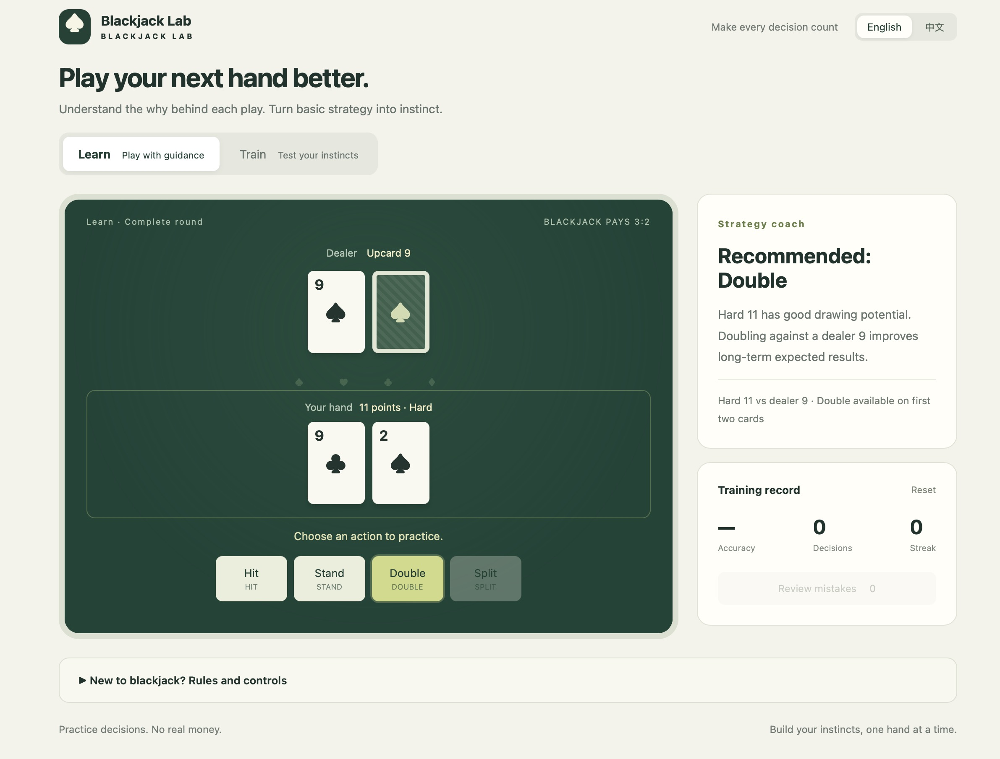

# Blackjack Lab

English | [简体中文](README.md)

A simple blackjack learning and practice game that explains basic strategy and helps you build better decision-making habits. No dependencies and no real money.

## Getting started

Download or clone this repository, then open [`index.html`](index.html) in your browser. No server, installation or internet connection is required.

## Features

- **Learn mode**: play complete rounds with basic strategy recommendations and explanations. Supports hit, stand, double and split.
- **Train mode**: choose an action before seeing the explanation. Track accuracy, decisions and your current streak, and review mistakes.
- **English and Chinese**: switch languages in the top-right corner without losing your current hand or training progress.
- **Local persistence**: language preference and training records are saved in the browser’s localStorage. On first use, the app follows the browser’s preferred language: Chinese for Chinese locales, English otherwise. A manual selection takes priority on later visits.

Language preference uses `bj-lab-language-v1`; training records use `bj-lab-v1`. Resetting training records keeps your language preference. Clearing browser data removes saved records. Persistence may be unavailable if your browser restricts storage for local files.

## Practice rules

Six decks, shuffled each round. Dealer stands on soft 17 (S17), with a US hole card and a blackjack peek. Double on any first two cards, including after splitting. Maximum four hands. Split aces receive one card each and cannot be split again. No surrender or insurance. Blackjack pays 3:2; 21 after splitting is a regular 21.

Train mode evaluates one decision per question, regardless of the outcome of a hand. Basic strategy improves long-term expected results; it does not guarantee a win.

Strategy reference: [Wizard of Odds · 4–8 deck basic strategy](https://wizardofodds.com/games/blackjack/strategy/4-decks/) (S17, no surrender).

## Project files

- `index.html`: standalone local version with inline CSS and JavaScript.
- `dist/index.html`: page that loads separate assets.
- `dist/style.css`: page styles.
- `dist/game.js`: game logic, basic strategy and training records.
- `dist/i18n.js`: translations and language preference.

After editing `dist/`, inline the updated CSS, `i18n.js` and `game.js` into the root `index.html` to keep both versions in sync.

## Contributors

- [T-O-N-G](https://github.com/T-O-N-G) — Project concept, requirements and feedback.
- Codex (OpenAI) — AI coding assistant contributing implementation, UI iterations, translation and validation.
