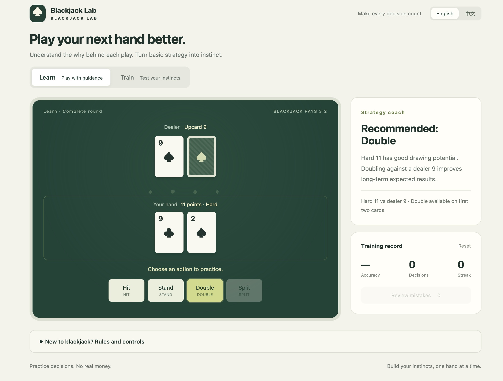

# Blackjack Lab · 21点练习室

A simple blackjack learning and practice game. Open [`index.html`](index.html) in your browser — no installation, server or internet connection required.

- **Learn**: play full rounds with basic strategy recommendations and explanations. Supports hit, stand, double and split.
- **Train**: choose before seeing the answer. Track accuracy and streaks, and review mistakes.
- **Languages**: English / 中文, with browser language detection and a saved preference.
- **Progress**: training records are saved locally in your browser.
- **Replay export**: copy the latest 20 rounds/questions for analysis with Codex, Claude or similar tools. Includes decisions, hand snapshots, strategy recommendations, splits, doubles and results. Hidden dealer cards appear only after a learning round finishes. Copy confirmations clear after two seconds; manual copying is available if the clipboard is restricted.

Six decks · Dealer stands on soft 17 · Double after split · No surrender · Blackjack pays 3:2. Full rules are available in the game.

Practice only, no real money. Basic strategy improves long-term expected results but does not guarantee a win.

---

## 中文

一个简洁的二十一点学习与训练游戏。用浏览器打开 [`index.html`](index.html) 即可游玩，无需安装、服务器或联网。

- **学习模式**：完整牌局，提供基础策略与理由，支持要牌、停牌、加倍和分牌。
- **训练模式**：先作答再看解析，记录正确率与连续答对次数，支持错题复习。
- **语言切换**：English / 中文，默认跟随浏览器语言，并记住手动选择。
- **进度保存**：训练记录保存在当前浏览器本地。
- **导出复盘**：复制最近 20 局／题，交给 Codex、Claude 等工具分析。记录每次决策、前后手牌、策略建议、分牌、加倍及结果；庄家暗牌只在学习牌局结束后导出。复制成功提示两秒后清除，受浏览器限制时可手动复制。

6 副牌 · 庄家软 17 停牌 · 分牌后可加倍 · 无投降 · Blackjack 赔付 3:2。完整规则见游戏内说明。

仅供练习，不涉及真钱。基础策略改善长期期望结果，不能保证获胜。

Strategy / 策略参考：[Wizard of Odds · 4–8 deck basic strategy](https://wizardofodds.com/games/blackjack/strategy/4-decks/).

修改 `dist/` 后，运行 `python3 build.py` 更新独立 HTML。

导出使用紧凑文本牌谱：只保留点数、操作和关键状态，省略花色、牌 ID 与重复快照；相同规则只写一次。浏览器内原始记录保留不变。

Exports use compact text notation: ranks, actions and key states, without suits, card IDs or duplicate snapshots. Shared rules appear once. Original browser records remain unchanged.
